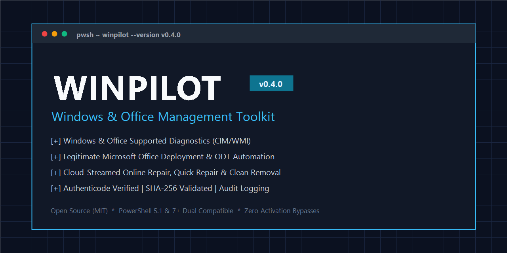

# WinPilot: Independent Windows & Office Management Toolkit

<p align="center">
  
</p>

[](https://github.com/winpilot/winpilot)
[](https://github.com/winpilot/winpilot)
[](https://github.com/winpilot/winpilot)
[](https://github.com/winpilot/winpilot)
[](SECURITY.md)

**WinPilot** is an open-source, modular Windows and Microsoft Office management and diagnostic toolkit designed for system administrators, IT professionals, and power users. Inspired by the interactive terminal ergonomics of Microsoft Activation Scripts (MAS), WinPilot is built from the ground up strictly for **legitimate systems administration**, **supported Microsoft API diagnostics**, **official Office deployment**, and **system maintenance**.

---

## Documentation Quick Links

| Guide | Description |
| :--- | :--- |
| **[Quick Start Guide](docs/QUICKSTART.md)** | Step-by-step setup, first-launch instructions, and common CLI workflows |
| **[Architecture Specification](docs/ARCHITECTURE.md)** | Technical design, subsystem blueprints, data flows, and security boundaries |
| **[Milestone History & Roadmap](docs/MILESTONES.md)** | Completed capabilities (M1–M4) and proposed future milestones |
| **[Changelog](CHANGELOG.md)** | Detailed release history adhering to Keep a Changelog conventions |
| **[Contributing Guidelines](CONTRIBUTING.md)** | Development environment setup, coding standards, and PR process |
| **[Code of Conduct](CODE_OF_CONDUCT.md)** | Community collaboration standards and professional expectations |
| **[Security Policy](SECURITY.md)** | Vulnerability disclosure instructions, SLAs, and security commitments |
| **[Support Guide](SUPPORT.md)** | Getting help, searching discussions, and opening structured issues |
| **[GitHub Growth Plan](docs/GITHUB_GROWTH_PLAN.md)** | 90-day organic community strategy, technical articles, and KPIs |

---

## Table of Contents

- [Core Principles & Security Invariants](#core-principles--security-invariants)
- [Feature Comparison Matrix](#feature-comparison-matrix)
- [Subsystems & Capabilities](#subsystems--capabilities)
  - [1. Interactive Terminal User Interface (TUI)](#1-interactive-terminal-user-interface-tui)
  - [2. Licensing & Activation Diagnostics](#2-licensing--activation-diagnostics)
  - [3. Legitimate Microsoft Office Deployment](#3-legitimate-microsoft-office-deployment)
  - [4. Office Maintenance & Lifecycle Management](#4-office-maintenance--lifecycle-management)
  - [5. Cryptographic Verification & Audit Logging](#5-cryptographic-verification--audit-logging)
- [System Requirements](#system-requirements)
- [Quick Start Guide](#quick-start-guide)
  - [Option A: Interactive Menu (TUI)](#option-a-interactive-menu-tui)
  - [Option B: PowerShell Module Import](#option-b-powershell-module-import)
- [CLI Command Reference (Scriptable & Headless)](#cli-command-reference-scriptable--headless)
  - [Diagnostics Commands](#diagnostics-commands)
  - [Office Deployment Commands](#office-deployment-commands)
  - [Office Maintenance Commands](#office-maintenance-commands)
  - [Security & Process Commands](#security--process-commands)
- [Repository Architecture](#repository-architecture)
- [Testing & Quality Assurance](#testing--quality-assurance)
- [Roadmap & Milestone Status](#roadmap--milestone-status)
- [Privacy & Compliance Statement](#privacy--compliance-statement)
- [License](#license)

---

## Core Principles & Security Invariants

WinPilot is engineered to adhere to strict enterprise security standards and legal compliance:

> [!IMPORTANT]
> **Zero Unauthorized Activation**: WinPilot contains **no activation bypasses, no KMS emulators, and no unauthorized licensing modifications**. All diagnostic functions query official, supported Windows and Office interfaces (`SoftwareLicensingProduct`, CIM/WMI, Click-to-Run registries) in read-only mode.

- **Legitimate Microsoft Tooling**: Office deployments and removals strictly use official Microsoft Office Deployment Tool (ODT) binaries (`setup.exe`) downloaded directly from Microsoft CDNs.
- **Strict Authenticode Verification**: Every downloaded binary is verified for Authenticode validity, exact publisher identity (`CN=Microsoft Corporation, O=Microsoft Corporation`), certificate-chain trust to the Microsoft Root Authority, and Code Signing Enhanced Key Usage (EKU `1.3.6.1.5.5.7.3.3`).
- **Hardened Network Streaming**: Downloads enforce HTTPS on port 443, reject URLs with embedded userinfo credentials, reject unapproved subdomains, limit redirects to 5 hops, and stream directly from verified HTTP 200 responses.
- **Licensing Privacy by Design**: Full 25-character Windows product keys are **never** displayed, stored, or logged. OEM BIOS/UEFI embedded keys are automatically masked (`XXXXX-XXXXX-XXXXX-XXXXX-K73QR`), displaying only the partial last-5 characters necessary for license identification.
- **PowerShell 5.1 & 7+ Dual Compatibility**: Fully functional on default Windows PowerShell 5.1 without requiring third-party runtime installations, while remaining fully compatible with PowerShell Core (pwsh 7+).
- **Safety Confirmations Defaulting to NO**: All destructive or system-altering actions require explicit interactive confirmation, defaulting to `[NO]`. High-risk operations require typing explicit `YES`.
- **Local Audit Trail**: All operations and user decisions are recorded with ISO 8601 timestamps and severity levels in local log files under `%ProgramData%\WinPilot\Logs`.

---

## Feature Comparison Matrix

| Feature / Capability | WinPilot v0.4.0 | Ad-Hoc Scripts | Activation Scripts | Manual ODT Setup |
| :--- | :---: | :---: | :---: | :---: |
| **Interactive Terminal TUI** | **Yes** (ANSI/VT100) | Rare (CLI only) | Yes (Batch/PS) | No (GUI wizard only) |
| **Zero Activation Bypasses / Legal** | **Yes (100% Legitimate)** | Varies | No (Bypass-focused) | Yes |
| **Supported CIM/WMI Licensing Audits** | **Yes** (Read-only) | Partial | No (Spoofing) | No |
| **OEM Product Key Privacy (Masked)** | **Yes** (`XXXXX-...-K73QR`)| Rare | No (Full key dumps) | N/A |
| **M365 Token vs Subscription Separation** | **Yes** | No | No | No |
| **Official ODT Auto-Acquisition** | **Yes** (Hardened HTTPS)| No (Manual) | No | No (Manual download) |
| **Authenticode & Root Chain Trust Check** | **Yes** (Strict X.500) | Rare | No | Manual cert properties |
| **Declarative Deployment XML Builder** | **Yes** (`New-WinPilotOfficeXml`)| No | No | Manual XML editing |
| **Click-to-Run Online & Quick Repair** | **Yes** (Supported APIs) | No | No | Manual Settings app |
| **Isolated Process Execution Wrapper** | **Yes** (`Invoke-WinPilotProcess`)| No | No | N/A |
| **Local Session Audit Logging** | **Yes** (Structured Logs)| No | No | No |
| **100% Automated Unit Test Suite** | **Yes** (109 Pester tests)| No | No | N/A |
| **PowerShell 5.1 & 7+ Dual Verified** | **Yes** | Rare | No | N/A |

---

## Subsystems & Capabilities

### 1. Interactive Terminal User Interface (TUI)
- **Zero-Dependency VT100/ANSI**: Automatically negotiates virtual terminal processing on modern Windows Terminal and traditional Windows Console host (`conhost.exe`).
- **Single-Keypress Navigation**: Interactive submenus with single-key execution (`1`–`9`, `ESC` or `0` to return/exit) and case-insensitive hotkey routing.
- **Dynamic Box Drawing**: Clean ASCII border layouts with adaptive column wrapping and consistent status banners (`INFO`, `SUCCESS`, `WARNING`, `ERROR`, `AUDIT`).

### 2. Licensing & Activation Diagnostics
- **Windows Licensing Audit**: Queries CIM/WMI `SoftwareLicensingProduct` for product name, license channel (Retail, OEM, Volume/MAK, KMS Client), license status (Licensed, Initial Grace, Notification), evaluation grace period, and permanent activation state.
- **Perpetual Office Diagnostics**: Discovers Office 2016, 2019, and 2021 LTSC licenses via OSPP and CIM providers without altering licensing records.
- **Microsoft 365 Subscription Diagnostics**: Explicitly separates cached licensing token presence from verified active subscription state. Queries Click-to-Run vNext subscription tokens, Shared Computer Licensing mode, and registry telemetry.
- **Component Store & System Health**: Integrates with DISM Component Store diagnostics (`CheckHealth`, `ScanHealth`), tracks system architecture, build revisions, and pending reboot flags.

### 3. Legitimate Microsoft Office Deployment
- **Official ODT Acquisition**: Securely downloads Microsoft Office Deployment Tool (`officedeploymenttool.exe`) from approved Microsoft hostnames (`download.microsoft.com`, `officecdn.microsoft.com`, `go.microsoft.com`).
- **Dynamic XML Configuration Builder** (`New-WinPilotOfficeXml`):
  - Suites: Microsoft 365 Apps for Enterprise (`O365ProPlusRetail`), Microsoft 365 Business (`O365BusinessRetail`), Office 2021 LTSC Volume (`PerpetualVL2021`).
  - Standalone Apps: Microsoft Visio Professional 2021, Microsoft Project Professional 2021.
  - Granular App Exclusions: Exclude Teams, OneDrive, Outlook, Access, Publisher, Groove, Lync, Bing.
  - Enterprise Options: Shared Computer Licensing (multi-user RDS/VDI), 64-bit and 32-bit architectures, custom language packs, and update channels (Current, MonthlyEnterprise, SemiAnnual).
- **Automated Deployment Runner**: Executes ODT in Download or Install mode with real-time exit-code mapping to documented Microsoft setup results (e.g. exit code 17002, 30182, 30088).

### 4. Office Maintenance & Lifecycle Management
- **Guided Quick Repair**: Detects Click-to-Run installations, launches the supported Windows Installed Apps interface (`ms-settings:installed-apps`), and guides the user through local file verification without internet dependency.
- **Cloud-Streamed Online Repair**: Invokes Microsoft's documented command:
  ```powershell
  OfficeClickToRun.exe scenario=Repair platform=$platform RepairType=FullRepair DisplayLevel=True forceappshutdown=True
  ```
  with dynamic architecture detection (`x86`/`x64`), administrator elevation checks, and clear data loss warnings for open applications.
- **Office Update Management**: Queries current update channels, checks whether updates are enabled, and triggers background update inspections using `OfficeC2RClient.exe /update user displaylevel=true`.
- **Clean Office Uninstallation**: Generates compliant ODT removal configurations (`<Remove All="TRUE" />`), presents full disclosures of all products and language packs being removed, provides Outlook mailbox and `.pst`/`.ost` data advisories, and guarantees temporary XML cleanup in `try/finally` blocks.

### 5. Cryptographic Verification & Audit Logging
- **SHA-256 File Integrity**: Computes cryptographic hashes and validates multi-file release manifests.
- **Authenticode Verification**: Validates publisher subject, root certificate authority, and Code Signing EKU.
- **Process Isolation Wrapper** (`Invoke-WinPilotProcess`): Ensures external processes are executed with strict timeout monitoring, error handling, and complete test isolation.
- **Tamper-Evident Audit Logs**: Outputs structured logs to `%ProgramData%\WinPilot\Logs\WinPilot_<date>.log`.

---

## System Requirements

| Requirement | Specification |
| :--- | :--- |
| **Operating System** | Windows 10 (Version 1809 or later), Windows 11 (all versions), Windows Server 2019/2022 |
| **PowerShell Version** | Windows PowerShell 5.1 (native built-in) **or** PowerShell 7+ (`pwsh`) |
| **User Privileges** | Standard User for Diagnostics; Elevated Administrator for Deployment, Online Repair & Uninstall |
| **Network** | HTTPS (Port 443) outbound access to official Microsoft domains (`*.microsoft.com`) |
| **Execution Policy** | `RemoteSigned` or `Bypass` for the local process scope |

---

## Quick Start Guide

### Option A: Interactive Menu (TUI)

1. Open PowerShell as **Administrator** (recommended for full deployment and repair capabilities).
2. Clone the repository and navigate to the folder:
   ```powershell
   git clone https://github.com/winpilot/winpilot.git
   cd winpilot
   ```
3. Launch WinPilot:
   ```powershell
   Set-ExecutionPolicy -ExecutionPolicy RemoteSigned -Scope Process -Force
   Import-Module .\src\WinPilot.psd1 -Force
   Start-WinPilot
   ```

```
╔════════════════════════════════════════════════════════════════════════════╗
║  WINPILOT - Independent Windows & Office Management Toolkit               ║
║  Console Host Architecture                                                 ║
╠════════════════════════════════════════════════════════════════════════════╣
  Status: [USER: ELEVATED] | PS 5.1 | WinBuild 26100 (AMD64)
╚════════════════════════════════════════════════════════════════════════════╝

  ╔══ MAIN MENU ══════════════════════════════════════════════════════════╗
  ║                                                                      ║
  ║  [1] Diagnostics & Licensing Auditing    (Supported Microsoft APIs)  ║
  ║  [2] Office Deployment Suite             (Official Microsoft ODT)    ║
  ║  [3] Office Maintenance & Repair         (C2R Quick/Online, Updates) ║
  ║  [4] Windows System & Store Health       (SFC, DISM, Component Store)║
  ║  [5] View Local Audit Log                (Session Transcripts)       ║
  ║                                                                      ║
  ║  [0] Exit WinPilot                                                   ║
  ║                                                                      ║
  ╚══════════════════════════════════════════════════════════════════════╝

  Select an option [0-5]: _
```

### Option B: PowerShell Module Import

WinPilot is a fully structured PowerShell module (`WinPilot.psd1`). You can import it into scripts or interactive sessions to access any of its 45 individual cmdlets directly:

```powershell
Import-Module .\src\WinPilot.psd1
```

For more examples, see the **[Quick Start Guide](docs/QUICKSTART.md)**.

---

## CLI Command Reference (Scriptable & Headless)

WinPilot cmdlets can be used non-interactively in automated pipelines, scheduled jobs, and remote management sessions.

### Diagnostics Commands

#### Windows Licensing Audit
```powershell
# Get structured licensing object
$winLic = Get-WinPilotWindowsLicense
$winLic.ActivationStatus     # e.g. "Licensed (Activated)"
$winLic.LicenseChannel       # e.g. "Retail", "OEM", "Volume"
$winLic.MaskedKey            # e.g. "XXXXX-XXXXX-XXXXX-XXXXX-K73QR" (masked for privacy)

# Render formatted terminal report
Show-WinPilotWindowsLicenseReport
```

#### Office Licensing Audit
```powershell
# Query perpetual licenses (LTSC / Retail / MAK)
$perp = Get-WinPilotOfficePerpetualStatus

# Query Microsoft 365 subscription status & cached vNext tokens
$m365 = Get-WinPilotOfficeSubscriptionStatus
$m365.SubscriptionTokenCount # Number of local license tokens
$m365.SharedComputerLicensing# Boolean for RDS/VDI activation

# Render complete Office licensing report
Show-WinPilotOfficeLicenseReport
```

#### System Health & Component Store
```powershell
# Inspect system specifications and DISM health
$health = Get-WinPilotSystemHealth
$health.IsRebootPending      # True if Windows Update reboot is required

# Run DISM check
Test-WinPilotComponentStore -ScanType CheckHealth
```

---

### Office Deployment Commands

#### Generate Deployment XML
```powershell
# Generate XML for Microsoft 365 Enterprise 64-bit excluding Teams and OneDrive
New-WinPilotOfficeXml -ProductId "O365ProPlusRetail" `
                      -Architecture "x64" `
                      -Channel "Current" `
                      -Languages @("en-us") `
                      -ExcludeApps @("Teams", "OneDrive") `
                      -OutputPath "C:\Deploy\office_config.xml"

# Generate XML for Office 2021 LTSC Volume with Shared Computer Licensing
New-WinPilotOfficeXml -ProductId "PerpetualVL2021" `
                      -SharedComputerLicensing `
                      -OutputPath "C:\Deploy\ltsc2021.xml"
```

#### Acquire Microsoft ODT Binary
```powershell
# Downloads setup.exe from Microsoft CDN, verifying exact Authenticode signature
$setupExe = Get-WinPilotOdt -TargetDirectory "C:\Deploy\ODT"
```

#### Execute Deployment
```powershell
# Download installation source files locally
Invoke-WinPilotOfficeDeploy -Mode "Download" -ConfigurationPath "C:\Deploy\office_config.xml"

# Install Office silently using validated configuration
Invoke-WinPilotOfficeDeploy -Mode "Install" -ConfigurationPath "C:\Deploy\office_config.xml"
```

---

### Office Maintenance Commands

#### Quick Repair (Interactive Supported GUI)
```powershell
# Opens Windows Installed Apps interface with step-by-step instructions
Invoke-WinPilotOfficeQuickRepair
```

#### Online Repair (Cloud Streamed Full Reinstall)
```powershell
# Requires Administrator elevation and explicit high-risk confirmation
Invoke-WinPilotOfficeOnlineRepair
```

#### Trigger Office Updates
```powershell
# Triggers background update check and download via Click-to-Run client
Invoke-WinPilotOfficeUpdate
```

#### Clean Office Uninstallation
```powershell
# Uninstalls all Click-to-Run Office suites with impact disclosures
Invoke-WinPilotOfficeUninstall
```

---

### Security & Process Commands

```powershell
# Calculate cryptographic SHA-256 hash
Get-WinPilotFileHash -Path "C:\Deploy\setup.exe"

# Test Authenticode signature validity and Microsoft Corporation publisher
Test-WinPilotAuthenticode -Path "C:\Deploy\setup.exe" -ExpectedSubject "Microsoft Corporation"

# Execute external process with timeout containment and exit code capture
Invoke-WinPilotProcess -FilePath "C:\Deploy\setup.exe" -ArgumentList "/configure C:\Deploy\config.xml"
```

---

## Repository Architecture

```
WinPilot/
├── .github/
│   ├── ISSUE_TEMPLATE/          # Structured issue templates for bugs and features
│   ├── PULL_REQUEST_TEMPLATE.md # Verification checklist for pull requests
│   └── workflows/
│       └── ci.yml               # GitHub Actions CI matrix (PowerShell 5.1 & pwsh 7+)
├── docs/
│   ├── assets/                  # High-resolution social preview and visual assets
│   ├── ARCHITECTURE.md          # Technical architecture & security specification
│   ├── GITHUB_GROWTH_PLAN.md    # 90-day organic growth & developer outreach strategy
│   ├── MILESTONES.md            # Detailed milestone history (M1-M4) & M5 roadmap
│   └── QUICKSTART.md            # Fast-track setup & scriptable workflow guide
├── src/
│   ├── WinPilot.psd1            # Module manifest (exported functions, metadata)
│   ├── WinPilot.psm1            # Module loader & interactive TUI orchestrator
│   ├── Core/                    # Host detection, AnsiUI, Input, Logger, Process wrapper
│   ├── Modules/
│   │   ├── Diagnostics/         # Windows CIM, Perpetual Office, M365 diagnostics
│   │   ├── OfficeDeploy/        # ODT downloader, XML builder, deploy runner
│   │   └── OfficeMaintenance/   # Quick/Online repair, updates, clean uninstall
│   └── Security/                # SHA-256 integrity, Authenticode & EKU verifier
├── tests/
│   ├── PSScriptAnalyzerSettings.psd1 # Strict static analysis rules
│   └── Unit/                    # 109 Pester unit tests across 5 test suites
├── CHANGELOG.md                 # Release history following Keep a Changelog
├── CODE_OF_CONDUCT.md           # Community collaboration and professional standards
├── CONTRIBUTING.md              # Developer contribution guidelines and testing instructions
├── README.md                    # Project documentation & master index
├── SECURITY.md                  # Vulnerability disclosure policy & SLAs
└── SUPPORT.md                   # User support channels and FAQ
```

---

## Testing & Quality Assurance

WinPilot maintains an extensive, zero-mock-leak test suite using Pester. Every pull request and release is validated across both **Windows PowerShell 5.1** and **PowerShell 7 (`pwsh`)**.

### Running Unit Tests Locally

To run the complete unit test suite (109 tests):

```powershell
$testFiles = Get-ChildItem -Path ".\tests\Unit" -Filter "*.Tests.ps1" | Select-Object -ExpandProperty FullName
Invoke-Pester -Script $testFiles -PassThru
```

### Static Analysis (PSScriptAnalyzer)

To verify compliance with PowerShell security and formatting standards:

```powershell
Import-Module PSScriptAnalyzer
Invoke-ScriptAnalyzer -Path '.\src' -Recurse -Settings '.\tests\PSScriptAnalyzerSettings.psd1'
```

---

## Roadmap & Milestone Status

- [x] **Milestone 1 — Core Host & Interface**: Architecture review, repository scaffold, module manifest, host detection, ANSI TUI engine, keyboard navigation, structured audit logger, Pester testing framework.
- [x] **Milestone 2 — Licensing Diagnostics**: Windows activation status via CIM, OEM embedded key masking, perpetual Office licensing diagnostics, Microsoft 365 subscription separation, Component Store diagnostics.
- [x] **Milestone 3 — Legitimate Office Deployment**: Hardened ODT download engine, redirect validation, strict Authenticode & X.500 publisher checks, dynamic XML generator, and deployment execution runner.
- [x] **Milestone 4 — Office Maintenance & Repair**: Guided Quick Repair, Cloud-Streamed Online Repair with architecture detection, update triggering, clean uninstallation with data preservation advisories, and process isolation.
- [ ] **Milestone 5 — System Troubleshooting & Repair** *(Awaiting Authorization - NOT STARTED)*: Component Store repair (`DISM /RestoreHealth`), System File Checker (`SFC /scannow`), Windows Update service and cache reset with automated backup, Network stack reset (TCP/IP, Winsock, DNS).
- [ ] **Milestone 6 — Distribution & Edge Delivery**: Build pipeline, single-file release bundler, and Vercel edge distribution endpoints with signed release manifests.
- [ ] **Milestone 7 — Integration Verification**: Windows Sandbox test matrix, automated verification gates, end-to-end telemetry testing.

For full milestone details, see **[docs/MILESTONES.md](docs/MILESTONES.md)**.

---

## Privacy & Compliance Statement

- **No Remote Telemetry**: WinPilot does not collect, transmit, or phone home any analytical data.
- **Local Logs Only**: Diagnostic output and session audit records remain entirely on your local machine under `%ProgramData%\WinPilot\Logs`.
- **Product Key Privacy**: WinPilot will **never** display or log full 25-character product keys. Embedded BIOS/UEFI OEM keys are masked by default (`XXXXX-XXXXX-XXXXX-XXXXX-#####`).
- **Intellectual Property**: WinPilot is an independent open-source tool. Microsoft, Windows, Microsoft Office, Microsoft 365, Visio, and Project are trademarks or registered trademarks of Microsoft Corporation. WinPilot is not affiliated with, endorsed by, or sponsored by Microsoft.

---

## License

WinPilot is released under the **[MIT License](LICENSE)**.

This license permits use, modification, distribution, and private or commercial use of the software, subject to preserving the copyright and permission notices and the warranty disclaimer set out in [LICENSE](LICENSE).
